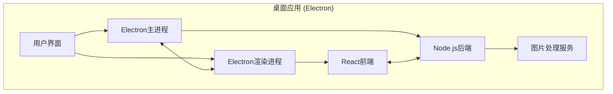

<div align="center">
  

<h1 align="center">LocalSqueeze</h1>

​			       

<div align="center">简体中文 | <a href="./README.en-US.md">English</a></div>
<h5 align="center">一款功能丰富、高效灵活的跨平台桌面图片压缩应用</h5>

</div>

## 📸 项目截图


## ✨ 特性
- **🔐 安全至上**：所有操作均在本地完成，零数据泄露风险
- **🔍 高质量压缩** - 智能压缩策略，在保持图片质量的同时最大程度减小文件大小
- **🚀 批量处理** - 同时处理多张图片，提高工作效率
- **📋 粘贴压缩** - 在首页或图片处理页按 Ctrl+V（Windows/Linux）或 ⌘V（macOS）粘贴图片或截图，按当前设置自动压缩；连续粘贴可排队处理
- **🎯 目标体积（可选）** - 在压缩设置中开启“每张图片小于 200 KB”等自定义目标，自动调整质量、颜色，必要时按允许的规则缩小尺寸；未达到目标会明确提示
- **🎨 PNG 压缩方式** - 默认推荐“减色压缩”，通常更明显地减小体积；可选“保色优化”，不主动减少颜色，保留渐变层次与平滑过渡，体积降幅通常较少。保色选择也会在目标体积模式下生效
- **🎨 体验优先**：直观的界面设计，流畅的操作体验
- **🔧 灵活配置**：丰富的压缩参数，满足专业用户需求
- **🌍 跨平台**：支持 Windows、macOS 主流平台
- **👁️ 效果对比** - 直观对比压缩前后的效果，确保图片质量
- **🌓 深色模式** - 支持深色/浅色主题切换

## 🏆 产品优势

### 🆚 与同类产品对比


#### 相比 TinyPNG

- 🔒 **隐私安全保障** - 100% 本地处理，图片数据不会上传到任何服务器，完全保护用户隐私
- 💪 **更优压缩效果** - 实测同一张图片，LocalSqueeze 压缩至 104KB，TinyPNG 压缩至 175KB，质量无差异
- 🚀 **无网络依赖** - 离线即可使用，不受网络环境限制
- 💰 **完全免费** - 无 API 调用限制，无需付费订阅
- 🔧 **高度可定制** - 支持压缩级别、格式转换等多种参数调整

#### 相比 Picdiet

- 🎯 **支持的图片格式更多** - Picdiet 仅支持 JPG
- 🎨 **更佳的交互体验** - 精心设计的用户界面，操作流程更加直观友好
- ⚙️ **更丰富的配置选项** - 提供更多自定义压缩参数，满足不同场景需求


## 🛠️ 技术栈



- ⚡ **Electron** - 跨平台桌面应用框架
- ⚛️ **React** - 用户界面构建
- 📘 **TypeScript** - 类型安全的 JavaScript 超集
- 🎨 **Tailwind CSS** - 实用优先的 CSS 框架
- 🔪 **Sharp** - 高性能 Node.js 图片处理库
- 🔨 **Electron Forge** - 应用打包与发布工具

## 🚀 快速开始

### 克隆项目

```bash
git clone https://github.com/freeany/LocalSqueeze.git
cd LocalSqueeze
```

### 安装依赖

```bash
npm install
```

### 启动开发环境

```bash
npm run start
```

## 📦 构建打包

```bash
# 构建当前平台的安装包
npm run make

# 构建Windows平台安装包
npm run make:win

# 构建macOS平台安装包
npm run make:mac
```

## 🚢 发布

```bash
# 发布当前平台的安装包到GitHub Release
npm run publish
```

### 自动化构建和发布

项目配置了GitHub Actions工作流，当推送带有标签的提交时（如`v1.0.1`），会自动触发构建并发布到GitHub Release。

```bash
git add .
git commit -m "release: v1.0.1"
git tag v1.0.1
git push && git push --tags
```

## 🗂️ 项目架构

```
src/
├── main.ts           # Electron主进程入口
├── preload.ts        # 预加载脚本
├── renderer.ts       # 渲染进程入口
├── app.tsx           # React应用入口
├── components/       # React组件
├── views/            # 页面视图
└── server/           # 服务端逻辑
    ├── compression/  # 图片压缩核心逻辑
    ├── ipc/          # 进程间通信
    ├── storage/      # 存储管理
    └── workers/      # 工作线程
```

## 📝 开源协议

本项目采用 [MIT](./LICENSE) 协议开源

## 📞 联系方式

- **作者**：lhr
- **邮箱**：lhr_freeany@163.com
- **项目主页**：[https://github.com/freeany/LocalSqueeze](https://github.com/freeany/LocalSqueeze)

## 🌟 支持项目

如果这个项目对你有帮助，欢迎点个 star ⭐️


## 图片尺寸处理（v1.1.0）

侧边栏按工具分组：“图片压缩”保留原有压缩设置、导入和导出；“图片尺寸处理”提供独立的尺寸与裁剪工作台、导出列表。

- 支持多图选择、拖放、Ctrl+V / ⌘V 粘贴和文件夹导入。
- 选择一寸、二寸、护照数字／纸质参考、国考源照片、美国签证参考，或自定义像素（如 150×200）。
- 拖动裁剪框移动选区，拖动边角缩放，方向键微调；每张图保留各自选区，可逐张或批量生成。
- 支持等比裁剪、等比留白、拉伸，以及 JPEG、PNG、WebP 和打印 DPI。PNG 默认不减色；尺寸输出允许放大，会提示细节不会随放大增加。
- 从原图生成精确像素，不使用屏幕预览图作为输出源；自动处理 EXIF 方向。设置与压缩模块独立，切换页面保留当前工作台。
- 两个工具复用导入、文件保存和批量导出通道，按操作类型区分历史；未标记的旧历史仍属于图片压缩。尺寸处理不计入压缩节省空间统计。
- 导出默认不覆盖同名文件，自动添加序号。生成结果保存在应用数据目录的 `resized-images/` 下，原图不被覆盖。

证件照预设仅提供尺寸和构图参考，不自动换背景或审核人像。数字照和纸质照片的比例可能不同；国考照片仍需通过当年官方照片处理工具。各预设在界面内附用途说明和适用来源，查阅日期为 2026-10-26。

规格参考：[一寸及考试照片](https://rsj.beijing.gov.cn/ywsite/bjpta/fwzn/cjwt/bm/cz/qgpt/202108/t20210821_2473438.html)、[2027 国考指南](https://shanghai.chinatax.gov.cn/xxgk/rsxx/202610/t481764.html)、[护照纸质照片](https://pg.china-embassy.gov.cn/lsyw/lszj/hzlxz/hzlzyq/202401/t20240103_11216467.html)、[护照数字照片](https://dj.china-embassy.gov.cn/lsfw/linshizhengjian/huzhaolvxingzheng/202311/P020231126826793735884.pdf)、[美国签证数字照片](https://travel.state.gov/content/travel/en/us-visas/visa-information-resources/photos.html)。

裁剪交互使用 [React Image Crop 11.1.2](https://www.npmjs.com/package/react-image-crop)，ISC 许可，声明见 [THIRD_PARTY_NOTICES.md](THIRD_PARTY_NOTICES.md)。像素输出复用项目现有 Sharp 依赖。


### 按要求配置（v1.2.0）

| 收到的要求 | 选择的方式 | 需要填写 |
| --- | --- | --- |
| 一寸、二寸、护照、国考照片 | 证件照 / 一寸二寸 | 选择预设并调整裁剪框 |
| 150×200 像素、3×4 厘米 | 指定宽高 / 像素 | 选择单位，填写宽高 |
| 只要求宽度或高度 | 指定宽高 / 像素 | 选择只指定一边，另一边自动计算 |
| 不超过 800×600 像素 | 指定宽高 / 像素 | 选择最大宽高范围，不裁剪、不放大 |
| 4:3、16:9、9:16、正方形 | 固定比例裁剪 | 选择比例，可额外指定输出宽度 |
| 整张图缩小到 50% | 按百分比缩放 | 输入百分比，批量时逐张计算 |

DPI 默认放在折叠的高级设置中。毫米／厘米及纸质照片预设按 DPI 自动计算像素，保持打印宽高；纯像素、比例、百分比模式不受 DPI 影响。比例裁剪默认尽量使用选区原像素，选区输出取整数比例；另行指定输出宽度时，高度四舍五入到整数像素。

保存格式可直接选择 JPG、PNG、WebP。“同时压缩”默认关闭，关闭时优先画质（JPEG 质量 100、PNG 不减色、WebP 无损）；裁剪、缩放或转换仍需重新编码。开启后可套用压缩模块当前的强度和颜色策略，同时指定文件体积。尺寸与格式以本页为准，不套用压缩模块的自动缩小尺寸选项。严格保持目标像素，无法满足体积要求会显示警告。PNG 保色模式隐藏无效的强度滑块。

交互参考：[Adobe Express 预设比例与自定义宽高](https://experienceleague.adobe.com/en/docs/journey-optimizer-b2b/user/content-management/assets/internal-dam/image-edit-adobe-express)、[Canva 图片尺寸工具](https://www.canva.com/features/image-resizer/)。

### PDF 压缩（v1.3.0）

侧边栏新增独立的 **PDF 压缩 → 导入与压缩 / 导出管理**。可选择多个 PDF、拖入文件，或导入文件夹中的 PDF（不递归子目录）。单个文件上限 150 MB，按顺序处理，某个文件失败不影响其余文件。

- **无损整理**：压缩内部对象和数据流，不重新编码图片。适合文字、矢量图和画质敏感文件。
- **均衡压缩**（默认）：内嵌图片 JPEG 质量 75，适合常见文档、扫描件。
- **强力压缩**：内嵌图片 JPEG 质量 45，优先减小体积，图片可能出现失真。
- **自定义**：内嵌图片质量 20–95；数值是图片质量，不是预期体积减少百分比。
- **目标体积**：可选设置每个 PDF 小于多少 MB；均衡/强力/自定义会继续尝试更低质量至 20，无损模式只整理结构。不能保证达标，未达标明确提示。

采用 [QPDF](https://qpdf.readthedocs.io/en/stable/cli.html#optimizing-file-size) 的本地 WASM 版本（QPDF 12.2.0，封装包 [@neslinesli93/qpdf-wasm 0.3.0](https://www.npmjs.com/package/@neslinesli93/qpdf-wasm)），随应用打包，无需安装外部程序；Mac / Windows 共用实现。仅对适用的内嵌图片进行重编码，保留页面尺寸、文字、矢量、链接和表单，不整页栅格化、不自动 OCR、不缩减图片像素。纯文字、已压缩图片或特殊图像编码的 PDF 可能减小不明显；若结果更大则导出原文件内容的副本。

当前拒绝加密、数字签名/签名字段、结构异常 PDF，避免产生无效签名或不完整文件。原文件不覆盖，所有成功结果均可在系统阅读器中预览、另存为或批量导出；历史和图片统计分离。特殊印刷、PDF/A、PDF/X 文件不保证保留其认证，请保留原件并验证。

开发验证：`npm run test:pdf`（含图片/文字/矢量/表单/链接/页数/体积/异常处理），`npm run test:pdf-ui`（真实 Electron 导入、处理、导出及隔离检查）。许可证见 THIRD_PARTY_NOTICES.md 和 licenses/。
